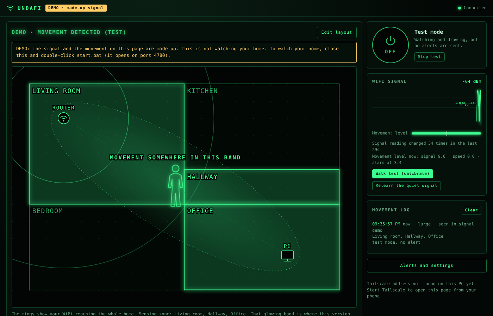

# UndaFi

A hobby project that notices movement at home by listening to WiFi.

It runs on a desktop PC, reads the WiFi readings that PC already has, and
shows a green floor plan in your browser. When something disturbs the WiFi
path between the PC and the router, it marks movement on the plan and can
send an alert to your phone or email.

The name mixes *unda* (Latin for "wave") and WiFi.



*The picture uses the built-in demo (a made-up signal) and the example
layout. It is not a real home.*

## Please read this first

- **Offered as is.** UndaFi comes with no warranty of any kind. See the
  [licence](LICENSE).
- **It makes no security claims.** It is not an alarm system and must not be
  relied on to protect people or property. It misses movement and it raises
  false alarms. Treat it as an experiment and an extra pair of eyes.
- **It is a hobby project.** Updates will be rare. Questions and pull
  requests are welcome, but there is no promise of support or of a reply.
- **Only watch your own home.** Use it where you live, with the knowledge of
  the people who live there.

## What it does

- Big ON / OFF button with a countdown, so you can leave before alerts start
- A floor plan you draw yourself, with the sensing zone glowing on it, in
  2D or as a simple 3D wireframe
- A guided walk test that measures what your PC can really sense
- Alerts by phone push ([ntfy](https://ntfy.sh)) and by email
- A movement log
- Reachable from your phone over [Tailscale](https://tailscale.com), with
  nothing exposed to the internet
- No accounts, no cloud, nothing to install except [Node.js](https://nodejs.org)

## How it works

1. **Your router is always sending radio waves.** They travel straight to
   your PC and also bounce off walls, furniture and people on the way.
2. **Your PC's WiFi card receives the mix** and reports a few numbers about
   it: how strong the signal is, and how fast the link currently is.
3. **A person changes the mix.** Bodies are mostly water, which absorbs and
   reflects WiFi waves. When someone moves through the path, the numbers
   shift.
4. **UndaFi watches for that shift.** It learns what "still" looks like,
   then flags movement when the readings are disturbed well beyond that.

It is not radar: nothing is sent out to "ping" the room, and the router does
not listen for echoes. The PC is the only listener. It is also not sound,
and uses no microphone or camera.

## What it can and cannot do

UndaFi works from very little: a signal-strength number and two link-speed
numbers, read a few times a second.

**It can:**

- notice movement in the band between the PC and the router (the glowing
  band on the floor plan);
- tell you which rooms that band passes through;
- guess "large" or "small" from how strongly the readings were disturbed.

**It cannot:**

- see movement outside that band. Your WiFi reaches the whole home, but the
  app can only listen at one place, the PC. Movement in other rooms does
  bounce the signal a little, but far too little for a PC's rough readings;
- be widened by a setting. Higher sensitivity catches weaker movement inside
  the band; it does not reach other rooms;
- find walls. You draw the floor plan once, by hand;
- tell which room in the band the movement is in. The figure on the map is
  only a marker for "somewhere in this band". It does not follow the person;
- tell a person from a pet. "Small" only means a weaker disturbance;
- react instantly. The figure appears a second or two after movement starts
  and stays about ten seconds after it stops.

### It depends a lot on your WiFi card

WiFi cards differ, and this decides how well UndaFi works for you:

- **Lively cards** report a signal that wobbles all the time. These sense
  movement best.
- **Sticky cards** report a flat line that only jumps in steps, or does not
  change at all. With these, UndaFi leans on the link speed instead, which
  is a weaker and noisier sign.
- **Some cards give too little either way.** The walk test will tell you so
  plainly. No setting fixes that.

Other things that matter:

- **The PC must be on WiFi.** A PC that uses only a network cable has no
  WiFi signal to listen to. Cable plus WiFi together is fine.
- **Distance helps.** A PC one or two rooms from the router gives a longer
  band and covers more of the home. A PC right next to the router covers
  almost nothing.
- **Mesh systems and band steering** can move the PC between access points
  or bands. Each move looks like a disturbance.
- **Busy air** (neighbours' WiFi, microwaves, a lot of streaming at home)
  adds noise and false alarms.

## Install and start

You need [Node.js](https://nodejs.org) version 20 or newer. Nothing else.

### Windows

1. Download this repository (green "Code" button, then "Download ZIP") and
   extract it, or clone it with git.
2. Double-click **`start.bat`**. The dashboard opens at
   `http://localhost:4780`.
3. Leave the black window open. Closing it stops UndaFi.

Windows also needs:

- **Location permission.** Newer Windows hides WiFi details unless
  Settings > Privacy & security > Location has "Location services" and "Let
  desktop apps access your location" switched on. The dashboard tells you if
  this is the problem.
- **To stay awake.** Set the PC to never sleep while you are away.

### Linux

```
node server.js
```

Then open `http://localhost:4780`. UndaFi reads `/proc/net/wireless`. Linux
support has had far less testing than Windows, and link speed is not read on
Linux yet.

### macOS

Not supported yet.

### Options

- `node server.js --port 4790` uses another port.
- `node server.js --demo` (or `try-demo-fake-signal.bat`) shows the
  dashboard with a **made-up** signal and made-up movement, on port 4781. It
  does not watch your home. It is marked DEMO everywhere and keeps its own
  separate log.

## First-time setup

1. **Draw your home.** Press "Edit layout". Drag the rooms, rename them, and
   drag ROUTER and PC to where they really are. Save.
   - Out of space? Raise the two "Grid" numbers (up to 80 x 80).
   - A rough sketch is enough. What matters is that PC and ROUTER sit in the
     right rooms.
2. **Run the walk test.** Press "Walk test (calibrate)" and follow the two
   steps: sit completely still for a minute, then walk between the PC and
   the router for 40 seconds. UndaFi measures both and tells you:
   - **good**: walking stands out, and sensitivity is set for you;
   - **weak**: it can tell a little; expect false alarms and misses;
   - **cannot tell the difference**: this PC's WiFi card cannot sense
     movement here.
3. **Set up alerts** (next section) and press "Save and send test alert".
4. **When you leave**, press the big button. After the countdown it is ON.
   Press it again to switch it OFF.

"Test at home (no alerts)" watches and draws without sending anything, for
trying things out.

## Alerts

Open "Alerts and settings" on the dashboard.

### Phone push (ntfy)

1. Install the free ntfy app on your phone
   ([Android](https://play.google.com/store/apps/details?id=io.heckel.ntfy),
   [iPhone](https://apps.apple.com/app/ntfy/id1625396347)).
2. In UndaFi, press "Make one" to get a random topic name.
3. In the ntfy app, tap + and subscribe to exactly that topic name.
4. Tick "Send push alerts to my phone" and save.

The topic name works like a password: anyone who knows it can read your
alerts, so keep it private. Alerts go through the public ntfy.sh service
unless you enter the address of your own ntfy server.

### Email

Enter your mail provider's SMTP details. For Gmail:

- Mail server `smtp.gmail.com`, port `465`
- Username: your Gmail address
- Password: an [app password](https://support.google.com/accounts/answer/185833),
  not your normal password

The password is saved only on your PC, in the `data` folder, and is never
shown again in the dashboard.

### What an alert says

The time, and the rooms the sensing band passes through. If monitoring is ON
and UndaFi cannot read the WiFi signal for a minute, it sends an alert
saying so.

## Settings

| Setting | What it does | Default |
|---|---|---|
| Sensitivity | 1 to 10. Higher catches weaker movement and gives more false alarms. The walk test sets this for you. | 7 |
| Also watch the WiFi link speed | Uses link speed as a second sign of movement. Helps on sticky cards. Switch off if it causes false alarms. | On |
| Keep the WiFi link busy | Sends a tiny packet to your router ten times a second while monitoring, so the card keeps its readings fresh. Stays inside your home network. | On |
| Movement must last at least | Seconds of disturbance before it counts. Longer ignores short blips. | 1 |
| Movement is over after this much quiet | Seconds of calm before the figure clears. | 3 |
| Time to leave after switching on | The countdown before alerts start. | 60 |
| Quiet time between alerts | Stops a burst of alerts for one visit. | 120 |

### The readings under the chart

- **"Signal reading changed N times"**: a lively card changes many times a
  minute. A sticky one barely changes.
- **Link speed** (the dotted line): the second sign of movement.
- **Movement level now**: how disturbed signal and speed are, and the level
  at which movement is declared.
- **Keeping the link busy**: whether the trickle to the router is running.

## Using it from your phone, fully locally

UndaFi never needs the internet, except to deliver the alerts you switch on.

To open the dashboard away from home, use [Tailscale](https://tailscale.com),
which links your own devices privately:

1. Install Tailscale on the PC and on your phone, and sign in on both.
2. Start UndaFi. The black window and the bottom of the dashboard show an
   address like `http://100.x.y.z:4780`.
3. Open that address on your phone.

How access is limited:

- The dashboard answers only on the PC itself and on its Tailscale address.
  Other devices on your home WiFi cannot open it, and nothing is opened to
  the internet.
- There is no password page. Anyone you let into your Tailscale network can
  open the dashboard and switch it off.
- The first time, Windows may ask whether to allow Node.js through the
  firewall. Allow it for private networks.

To keep alerts local too, run your own ntfy server and enter its address.

### Start with Windows (optional)

Press Win+R, type `shell:startup`, press Enter, and put a shortcut to
`start.bat` in the folder that opens. UndaFi remembers whether it was ON and
carries on after a restart, with the countdown again.

## Your data

- Settings, floor plan and the movement log are plain files in the `data`
  folder next to the app. Delete the folder to start fresh.
- `data` is never committed to git.
- Nothing leaves the PC except the alerts you switch on.

## Making it better: ESP32-S3 sensor boards (planned, not built)

**This part is a plan. UndaFi cannot use these boards yet.** It is written
down so that anyone who wants to build it knows where the project is headed.

A PC's WiFi card gives one rough number. A small ESP32-S3 board (roughly 10
euros) can report *channel state information*: the signal split into dozens
of separate frequencies, many times a second. That is the kind of data the
research systems use, and it is far more sensitive to movement.

What boards would add:

- movement sensed in every room that has a board, not only in one band;
- the right room shown on the floor plan;
- a fairer person / pet guess, and fewer false alarms.

Rough planning numbers. These come from how WiFi sensing is generally done
and have **not** been tested with UndaFi:

| Home | Boards | Where |
|---|---|---|
| Studio or one large room | 1 to 2 | Opposite the router, so the path crosses the room |
| 2 to 3 rooms | 3 | One per room |
| 4 to 6 rooms | 4 to 6 | One per room you care about |
| Two floors | 3 or more per floor | Treat each floor as its own home |

Rules of thumb:

- One board per room you want watched. A board senses the path between
  itself and the router.
- Place each board so that path crosses where people walk, 3 to 8 metres
  from the router, at about chest height.
- A router near the middle of the home gives every board a useful path.
- Each board needs a USB power supply.

The app is already built around "links" (one sensor, one path, its own
detector), so boards would be added as more links. What is missing is the
board firmware and a way for boards to report to the app. Help is welcome:
see [CONTRIBUTING.md](CONTRIBUTING.md).

## What has and has not been tested

Tested automatically (`npm test`):

- the movement detector, on simulated signals;
- reading Windows' WiFi report, from sample text in English and German;
- ON/OFF, the countdown, alert rules, the walk test, the event log;
- email sending, against a local test mail server;
- the keep-busy trickle, the web protections, and the dashboard in a browser
  with the demo signal.

Tested by hand so far: one Windows PC, in one home.

- Its WiFi card is a sticky one: the signal reading changed once in two
  minutes.
- The link speed carried the sensing. In the walk test, sitting still
  scored 1.9 and walking between the PC and the router scored 13.8, a
  "good" result, and movement was logged as "seen in link speed".
- That was a deliberate walk back and forth along the band. A single
  crossing, or movement elsewhere in the home, has not been measured.

**Not tested:** other WiFi cards, real Gmail, the real ntfy.sh service,
Linux on real hardware, and long unattended runs.

## For developers

No dependencies. `npm test` runs the checks.

- `server.js`: start-up, ports, Tailscale addresses
- `src/detector.js`: the movement maths
- `src/sensors/`: reading the WiFi card (Windows, Linux, demo)
- `src/probe.js`: the keep-busy trickle
- `src/engine.js`: ON/OFF, events, alerts, the walk test
- `src/notify/`: ntfy and email
- `src/http.js`: the dashboard's web server
- `public/`: the dashboard

## Licence and credit

UndaFi is open source under the [Apache License 2.0](LICENSE). You may use,
change and share it, including commercially, as long as you keep the
copyright and licence notices and the [NOTICE](NOTICE) file, and say what
you changed.
